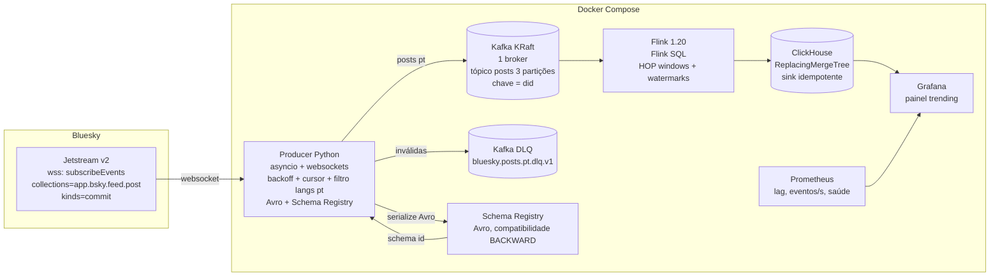

# bluesky-trends

Pipeline de streaming em tempo real que consome o **Jetstream do Bluesky**, filtra posts em português e calcula **trending de hashtags/termos**, **volume de posts por minuto** e **detecção de picos**, com painel ao vivo.

Projeto de portfólio de engenharia de dados: **Kafka (KRaft) + Schema Registry (Avro) + Flink SQL + ClickHouse + Grafana + Prometheus**, tudo em Docker Compose com limites de recursos, testes automatizados e CI/CD.

## Estado atual — Fase 1 (de 5)

- [x] **Fase 1** — Producer Python (Jetstream v2 → Kafka) + Kafka KRaft + Schema Registry, Avro com evolução de schema, tópico de dead letters, testes unitários e de integração, CI no GitHub Actions
- [ ] **Fase 2** — Job Flink com janelas de trending (HOP 5 min / slide 1 min) e volume por minuto
- [ ] **Fase 3** — Sink ClickHouse + painel Grafana
- [ ] **Fase 4** — Detecção de picos + métricas Prometheus + alertas
- [ ] **Fase 5** — Deploy na VPS (nginx + autenticação, health checks, CI/CD de deploy)

## Arquitetura (alvo completo)



## Como rodar local

Pré-requisitos: Docker com Compose v2, Python 3.12 (para os testes).

```bash
cp .env.example .env
make up          # Kafka + Schema Registry + producer (conecta no Jetstream real)
make logs-producer
make consume-check   # decodifica e imprime 10 mensagens Avro do tópico
make down
```

Testes e lint:

```bash
make install          # dependências de dev do producer
make test-unit        # parsing, filtro, Avro, cursor, pipeline
make test-integration # sobe Kafka+SR no Compose e valida o fluxo ponta a ponta
make lint
```

O teste de integração não depende do Bluesky: o producer tem um modo `INPUT_MODE=file` que lê um fixture JSONL (`producer/tests/fixtures/jetstream_frames.jsonl`) com os mesmos frames do formato v2. É esse modo que a CI usa.

### Serviços e orçamento de memória

| Serviço | Imagem | Limite | Heap |
|---|---|---|---|
| Kafka (KRaft combined, 1 broker) | `confluentinc/cp-kafka:7.7.1` | 1 GB / 0.5 CPU | 512 MB |
| Schema Registry | `confluentinc/cp-schema-registry:7.7.1` | 512 MB / 0.3 CPU | 256 MB |
| Producer | build local | 256 MB / 0.5 CPU | — |

Kafka e Schema Registry publicam apenas em `127.0.0.1` (nada exposto à internet). Na VPS (Fase 5) essas portas saem do Compose e o Grafana entra atrás do nginx existente com autenticação.

## Decisões (ADRs curtos)

### ADR-001 — Jetstream v2 em vez da v1
O endpoint v2 (`/xrpc/network.bsky.jetstream.subscribeEvents`) é o recomendado para projetos novos: filtro server-side por `collections` (não mais `wantedCollections`) e `kinds`, campo `cursor` em cada evento e envelope `{\"$type\": \"message\", \"payload\": {...}}` com subprotocolo `xrpc.v1.json`. A v1 continua de pé, mas é legada. **Trade-off:** v2 é mais novo e pode mudar mais; mitigamos com parsing defensivo e DLQ.

### ADR-002 — Kafka em modo KRaft, 1 broker
Desde o Kafka 4.0 o ZooKeeper não existe mais; KRaft é o único modo. Um único broker em modo *combined* (broker+controller) é suficiente: o volume de posts em português é de poucos milhares de eventos/s no máximo. **Trade-off:** sem replicação (`replication.factor=1`) não há tolerância a falha do broker — aceitável porque os dados são recomputáveis a partir do Jetstream e a agregação final vive no ClickHouse.

### ADR-003 — Chave de partição = `did` do autor
Mensagens do mesmo autor caem sempre na mesma partição, o que preserva ordenação por autor e equilibra bem a carga (muitos autores distintos). Alternativas descartadas: chave pela URI do post (ordenação inútil, distribuição quase aleatória) e chave nula (round-robin, sem nenhuma ordenação). Como as agregações do Flink são por janela de tempo e juntam todas as partições, o `did` dá o melhor trade-off. O paralelismo do consumer fica em 3, igual às partições.

### ADR-004 — Avro + Schema Registry, compatibilidade BACKWARD
O schema (`schemas/post_event_v1.avsc`) é versionado no repositório e registrado no startup com `auto.register` implícito controlado: o producer registra o schema do arquivo e falha se o registro rejeitar. Estratégia de evolução: novos campos sempre opcionais (`[\"null\", ...]` + `default`); nunca remover/renomear campo em uso; mudanças incompatíveis → novo sufixo de versão no tópico (`bluesky.posts.pt.v2`). **Trade-off:** Avro exige o Registry como dependência a mais, mas dá contrato explícito, evolução segura e binário compacto — é o que se quer demonstrar num portfólio.

### ADR-005 — Tempo de evento vs tempo de processamento
O schema carrega **dois timestamps**: `event_time` (o `createdAt` do post, quando o autor escreveu) e `ingest_time` (o `time` do payload Jetstream, quando a rede emitiu o evento). O Flink (Fase 2) usará `event_time` para as janelas, com watermark de desordem limitada; `ingest_time` serve para medir latência ponta a ponta. A diferença entre os dois é o que explica janelas "reabrindo" quando um post antigo chega atrasado.

### ADR-006 — Entrega at-least-once e deduplicação downstream
O Jetstream garante at-least-once (o cursor é inclusivo e eventos podem repetir após reconexão) e o producer Kafka é idempotente (`enable.idempotence=true`, `acks=all`), mas a duplicata *lógica* (mesmo post reemitido) é aceita no tópico. A deduplicação real será pelo `uri` no ClickHouse (`ReplacingMergeTree`, Fase 3) — idempotência no sink, não na frente. Isso mantém o producer simples e honesto com a semântica da fonte.

### ADR-007 — Dead letters em vez de crash
Frames que falham no parsing ou na validação vão para `bluesky.posts.pt.dlq.v1` com headers `error.stage` e `error.reason`; o job continua. Eventos `update`/`delete` de post são **descartados com contador** (não são erro: post editado/deletado não tem `record` e não há o que agregar). **Trade-off:** descartar perde o sinal de edição; se um dia for relevante, o contador vira métrica e os eventos vão para um tópico próprio.

### ADR-008 — Filtro de idioma no producer, com subtag primária `pt`
O Jetstream não filtra por idioma server-side; o campo `langs` do record é filtrado no producer. Aceitamos qualquer código com subtag primária `pt` (pt-BR, pt-PT), incluindo posts multilíngues (`[\"en\", \"pt-BR\"]`). **Trade-off:** `langs` é declarado pelo cliente do usuário e pode estar errado/ausente; post sem `pt` declarado é descartado mesmo se escrito em português. É o custo padrão desse tipo de filtro.

### ADR-009 — Hashtags extraídas no producer, termos no Flink
As hashtags vêm prontas nos `facets` do record (`app.bsky.richtext.facet#tag`) e são serializadas no schema como `hashtag_entities`. Termos livres (n-gramas do texto) ficam para o Flink (Fase 2), onde a tokenização faz parte da lógica de agregação. Isso mantém o schema rico e o job SQL simples.

### ADR-010 — Flink 1.20 LTS
Escolhemos a linha 1.20 (LTS) em vez da 2.x: os conectores Kafka/Avro/Schema Registry e o material de estudo da 1.20 são maduros, e a API Flink SQL usada aqui é estável nas duas linhas. **Trade-off:** 2.x é o futuro do projeto Flink; quando os conectores da linha 2.x estabilizarem, a migração é baixo risco porque o job é SQL.

### ADR-011 — Fases com orçamento de memória desde o dia 1
Todo container nasce com `mem_limit`/`cpus` e heaps explícitos (Kafka 512 MB, Registry 256 MB), mesmo em desenvolvimento. O orçamento total do pipeline é ~7 GB numa VPS compartilhada com outro site em produção; os limites garantem que o pipeline nunca dispute recursos com ele.

## Estrutura

```
├── docker-compose.yml        # Kafka KRaft, Schema Registry, kafka-init, producer
├── schemas/post_event_v1.avsc
├── producer/
│   ├── Dockerfile
│   ├── pyproject.toml
│   ├── src/producer/
│   │   ├── main.py            # loop asyncio: frames → filtro → Avro → Kafka
│   │   ├── jetstream_client.py# URL v2, websocket com subprotocolo e stall timeout
│   │   ├── parsing.py         # envelope v2 → PostEvent (validação)
│   │   ├── filters.py         # langs com subtag primária pt
│   │   ├── avro_serde.py      # registro no Schema Registry + wire format Avro
│   │   ├── kafka_producer.py  # producer idempotente + DLQ
│   │   ├── cursor_store.py    # persistência atômica do cursor (seq)
│   │   ├── consume_check.py   # CLI p/ consumir e decodificar (debug)
│   │   └── settings.py        # config via env
│   └── tests/
│       ├── fixtures/jetstream_frames.jsonl
│       ├── unit/
│       └── integration/test_flow.py
├── .github/workflows/ci.yml   # ruff + pytest unit + integração com Compose
└── Makefile
```

## CI/CD

O workflow [`.github/workflows/ci.yml`](.github/workflows/ci.yml) roda em todo push/PR:
1. **lint-unit**: `ruff check` + `ruff format --check` + `pytest` unitário (sem Docker).
2. **integration**: sobe Kafka + Schema Registry no Compose, produz o fixture em modo arquivo e valida ponta a ponta (posts Avro decodificáveis no tópico, inválidos na DLQ).

Nenhum segredo é necessário: o Jetstream é público e gratuito e não há credenciais no repositório.

## Roadmap detalhado

- **Fase 2 (Flink):** job Flink SQL consumindo o tópico Avro via `avro-confluent`, janelas `HOP` de 5 min deslizando 1 min para hashtags/termos, `TUMBLE` de 1 min para volume, watermarks sobre `event_time` e política para eventos atrasados documentada.
- **Fase 3 (ClickHouse + Grafana):** MergeTree/ReplacingMergeTree dedup por `uri`, dashboards de trending e volume.
- **Fase 4 (picos + observabilidade):** z-score sobre janelas, exportadores de métricas (lag do consumer, eventos/s, DLQ/s), alertas.
- **Fase 5 (VPS):** deploy atrás do nginx existente com autenticação no Grafana, health checks, CI/CD de deploy via Actions.
